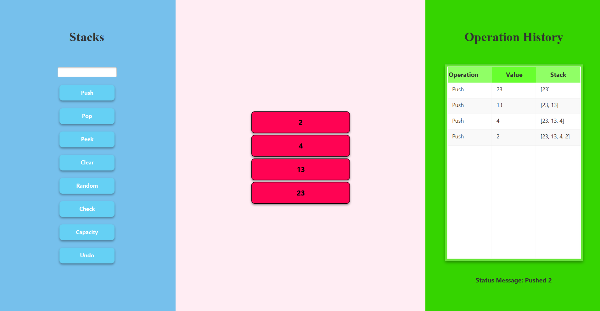

# Stack Visualization

## Project Title
**Stack Visualization**

## Group Name
**Powerpuff Boys**

## Group Members
1. Cuevas, Sheire Nyle
2. Jagunos, Holly Kent
3. Chatto, Jhyril Kish
4. Baladec, Thayan Ryan
5. Gulle, Kurt Dwayne
6. Oloroso, Zyrell Kent

## Description of the Program
Stack Visualization is a Java-based desktop application developed using JavaFX. It demonstrates how a stack data structure works by allowing users to perform stack operations and view the changes through a graphical interface.

## Features
- **Push:** Adds a value to the top of the stack.
- **Pop:** Removes the top value from the stack.
- **Peek:** Displays or identifies the top value without removing it.
- **Clear:** Removes all values from the stack.
- **Random:** Generates random values for the stack.
- **Check:** Checks whether the stack is empty or full.
- **Capacity:** Allows users to change the maximum stack capacity.
- **Undo:** Reverses the previous operation, where supported.
- **Stack Visualization:** Displays the stack values graphically.
- **Operation History:** Records user actions and relevant stack information.

## Requirements
- Java Development Kit (JDK) compatible with the project configuration
- IntelliJ IDEA or another Java IDE
- Apache Maven
- JavaFX dependencies configured in `pom.xml`

## How to Run the Program
1. Clone or download the project repository.
2. Open the project in IntelliJ IDEA.
3. Make sure the required JDK and Maven dependencies are configured.
4. Allow Maven to load and resolve the project dependencies.
5. Locate the main JavaFX application class, `Launcher.java`.
6. Run the application through the IDE or the configured Maven JavaFX run command.

## Project Structure
- `src/main/java/com.example.stackvisualizationgrouppowerpuffboys` — Contains the Java source code.
    - `Launcher.java` - Calls and Launches the Stack application. 
    - `Stack.java` — Implements the stack data structure and its core operations.
    - `StackApplication.java` — Implements the JavaFX interface and connects user actions to stack operations.
- `src/main/resources/css/style.css` — Defines the visual styling of the application.
- `pom.xml` — Defines Maven project settings and dependencies.
- `README.md` — Contains project documentation.

## Stack Implementation
The program uses an array-based stack with the **Last In, First Out (LIFO)** principle. The last value pushed onto the stack is the first value removed.

The `Stack.java` class manages the stack's data and operations, while `StackApplication.java` displays the stack and handles user interactions.

## Screenshot
Screenshot of the application are provided below to demonstrate the graphical interface and its main features.

## AI Disclosure
The group used **ChatGPT and Claude** to brainstorm architectural approaches and refine programming strategies. The technology was utilized exclusively as a conceptual sounding board to discuss logical frameworks and ideas to approach. No source code was generated, modified, or directly copied from the AI tool into the final software application or manuscript. Following the use of this technology, the author(s) independently evaluated, verified, and implemented the discussed concepts, and maintain full accountability for the design, integrity, and final contents of the work.

## 12. Contributors
This project was developed collaboratively by the five members of **Powerpuff Boys**. Each member contributed to the development, testing, documentation, or improvement of the application.

See the repository's commit history and pull requests for individual contributions.
